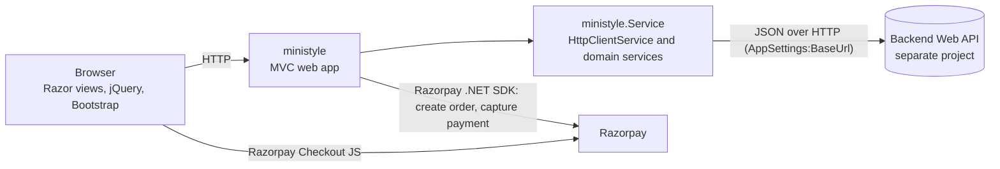

# Mini Style – E-commerce Client (Frontend)


-5C2D91)


> **Scope:** This document covers **only the Client (customer-facing storefront)** of the Mini Style project.
> The Console (Admin Panel) and Service (Backend Web API) are separate projects and are documented separately.

---

## Table of Contents

1. [Project Overview](#1-project-overview)
2. [Key Features](#2-key-features)
3. [Technologies Used](#3-technologies-used)
4. [Project Screens and Modules](#4-project-screens-and-modules)
5. [Project Folder Structure](#5-project-folder-structure)
6. [API Integration Overview](#6-api-integration-overview)
7. [Installation and Setup Instructions](#7-installation-and-setup-instructions)
8. [Configuration Details](#8-configuration-details)
9. [How to Run the Project](#9-how-to-run-the-project)
10. [Dependencies and Packages](#10-dependencies-and-packages)
11. [Important Notes](#11-important-notes)

---

## 1. Project Overview

**Mini Style** is an online kids' clothing store (newborn to 12 years) based in Surat, Gujarat, India. This repository part is the **customer-facing website**: a server-rendered **ASP.NET Core 8 MVC (Razor)** application that lets visitors browse products by category, view product details, add items to a cart and pay online through **Razorpay**.

The Client contains **no database and no business logic for products, carts or orders**. All data is read from and written to a separate **REST Web API** (the Service project) over HTTP. The Client's responsibilities are:

- Rendering pages (Razor views + Bootstrap 5 + jQuery).
- Calling the backend API through a typed service layer.
- Managing an anonymous cart identifier (cookie).
- Orchestrating the Razorpay payment flow.

### Architecture at a glance



### Solution layout (`ministyle.sln`)

| Project | Type | Role |
|---|---|---|
| `ministyle` | ASP.NET Core Web (net8.0) | Controllers, Razor views, static assets, startup |
| `ministyle.Domain` | Class library (net8.0) | DTO/view models (`Product`, `Cart`, `Order`, …) and `AppSettings` |
| `ministyle.Infrastructure` | Class library (net8.0) | Service interfaces (`IService/*`), enums, helpers |
| `ministyle.Service` | Class library (net8.0) | Service implementations and the `HttpClientService` wrapper that calls the API |

Dependency direction: `ministyle` → `Service` → `Infrastructure` → `Domain` (the web project also references all three directly).

---

## 2. Key Features

### Implemented and wired to the backend

- **Category browsing** – dedicated pages for **New Born**, **Girls** and **Boys** (a **Unisex** page also exists at `/Unisex` but is hidden from the navigation menu). Products for each page are fetched from the API by category ID.
- **Subcategories** – active subcategories for the current category are fetched from the API and shown as a pill/tab strip (display only – see [Important Notes](#11-important-notes)).
- **Product cards** – image (Base64 from the API), name, discounted price and original (strike-through) price, formatted in Indian Rupees (`en-IN`).
- **Product details page**
  - Image gallery with thumbnails (Swiper).
  - Colour swatches; selecting a colour reloads the images for that colour via AJAX.
  - Age-group (size) dropdown and quantity selector (1–10).
  - Size-chart modal with **cm / in** tabs, loaded on demand via AJAX.
  - Accordion with product description and care instructions (HTML supplied by the API).
  - Client-side validation: colour and age group must be selected before adding to cart.
- **Shopping cart**
  - Add to cart (AJAX, toast notification via Toastr).
  - Cart list and price summary (total item price, discount, shipping fee, total) loaded via AJAX partials.
  - Anonymous cart identified by a `CartSession` cookie (GUID, 7 days, `HttpOnly`, `Secure`).
- **Checkout and payment**
  - Shipping-address form with client-side validation; the last entered address is remembered in the browser (`localStorage`, key `userData`) and pre-filled next time.
  - Server-side Razorpay order creation (currency **INR**), Razorpay Checkout pop-up, server-side payment fetch and capture, then order creation in the backend API.
  - Success and failure result pages.
- **SEO groundwork** – per-page `<title>`, meta description and keywords, canonical URL, and a `ClothingStore` JSON-LD block in the shared layout.
- **Responsive layout** – Bootstrap 5 grid, collapsible navbar, `viewport` meta tag and a dedicated `responsive.css` with breakpoints from 320 px upward.
- **Site chrome** – page-loader video, sticky header on scroll, back-to-top button, floating social-links widget (Instagram, map, WhatsApp), footer with store contact details.

### Present in the UI but **not functional** (no handler or backend call)

| Item | Where | Current state |
|---|---|---|
| Product search | Header search icon → "Find Your Style" modal | Form has no submit handler or API call |
| Sort By | Category list pages | Dropdown items link to `#`; no sorting logic |
| Subcategory filtering | Category list pages | Pills render subcategory names but do not filter products |
| Contact form | `/ContactUs` | Form has no action or script; nothing is submitted |
| Cart quantity and delete controls | `Views/Cart/_List.cshtml` | Markup is commented out (JS handlers and controller actions exist) |
| Cash / Pay on Delivery | Product details info tab | Informational text only, contains template placeholders; checkout supports Razorpay only |
| Filter side-panel | `Views/Unisex/_List.cshtml` | Commented out |
| Admin login / dashboard | `/Admin/Authentication`, `/Admin/Dashboard` | Static templates only (see below) |

### Not implemented in the Client

- Customer registration, login, accounts or order history.
- Wishlist / favourites.
- Product search, working sort or working filters.
- Authentication or authorization (no `[Authorize]`, no authentication middleware).
- Pagination.
- Automated tests.

---

## 3. Technologies Used

| Layer | Technology |
|---|---|
| Framework | **ASP.NET Core 8.0 MVC** with **Razor** views (`Microsoft.NET.Sdk.Web`, `net8.0`, nullable and implicit usings enabled) |
| Language | C# |
| Architecture | Layered solution: Web → Service → Infrastructure (interfaces) → Domain (models); built-in ASP.NET Core dependency injection |
| HTTP / API access | `IHttpClientFactory` + `System.Text.Json` via a custom `HttpClientService` |
| Payments | **Razorpay** (.NET SDK server-side, Razorpay Checkout JS client-side) |
| UI | HTML5, CSS3, **Bootstrap 5.2.3**, custom `style.css` / `responsive.css` |
| Client-side scripting | **jQuery**, AJAX partial-view loading, `AspNetCore.Unobtrusive.Ajax` (`Html.AjaxBeginForm`) |
| UI components | **Swiper 11.1.15** (galleries, home sliders), **Owl Carousel 2.3.4** (subcategory strip), **Toastr** (notifications), Bootstrap modal / accordion / tabs / dropdown |
| Icons and fonts | Font Awesome (Kit loader script), Google-hosted web fonts referenced in `SiteFonts.css` |
| IDE / tooling | Visual Studio 2022 solution (format 12.00); IIS Express, Kestrel (`http`, `https`) launch profiles |

---

## 4. Project Screens and Modules

Default route pattern: `{controller=Home}/{action=Index}/{id?}`.

| Screen | URL | Controller / View | Data source | Notes |
|---|---|---|---|---|
| Home | `/` | `HomeController` / `Home/Index` | Static | Hero banner, category tiles (New Born, Girls, Boys), Swiper "bestseller" and testimonial sliders, About section, FAQ accordion |
| About Us | `/AboutUs` | `AboutUsController` | Static | Brand story, value highlights, FAQ |
| Contact Us | `/ContactUs` | `ContactUsController` | Static | Form is UI only |
| New Born | `/NewBorn` | `NewBornController` (`Index`, `List`) | API | Category ID `1` |
| Girls | `/Girls` | `GirlsController` (`Index`, `List`) | API | Category ID `2` |
| Boys | `/Boys` | `BoysController` (`Index`, `List`) | API | Category ID `3` |
| Unisex | `/Unisex` | `UnisexController` (`Index`, `List`) | API | Category ID `4`; link commented out of the navigation menu |
| Product Details | `/ProductDetails/Index/{id}` | `ProductDetailsController` | API | Also exposes AJAX endpoints: `AddToCart` (POST), `GetProductImages`, `GetProductChart`, `GetSizeChartRows` |
| Cart | `/Cart` | `CartController` (`Index`, `List`, `GetCartSummary`, `Delete`, `UpdateQty`) | API | `List` and `GetCartSummary` return partials loaded via AJAX |
| Checkout | `/Checkout` | `CheckoutController` | API + Razorpay | `Index`, `List`, `GetCartSummary`, `CreateOrder`, `CompletePayment` (POST), `Success`, `Failure`, `SaveDetails` (POST) |
| Baby Product (template) | `/BabyProduct` | `BabyProductController` | Static | Static template page; not linked from the navigation |
| Error | `/Home/Error` | `HomeController.Error` | – | Used by the exception handler outside Development |
| Admin login (template) | `/Admin/Authentication/Index` | `Areas/Admin` | Static | Static login form with no submit logic |
| Admin dashboard (template) | `/Admin/Dashboard/Index` | `Areas/Admin` | Static | Empty view. The real admin panel is the separate Console project |

### Shared layout (`Views/Shared/_Layout.cshtml`)

Header navigation (Home, About, Fashion ▸ New Born / Girls / Boys, Contact Us, search icon, cart icon), page-loader video, footer with store details and payment strip, social widget, back-to-top button, SEO meta tags, canonical link and JSON-LD structured data.

### Category and product model

- Categories are defined in `ministyle.Infrastructure/Enums.cs`: `NewBorn = 1`, `Girls = 2`, `Boys = 3`, `Unisex = 4`.
- On page load each category page sends an AJAX `POST /{Category}/List`. The controller sets `SearchCriteria.CategoryId` to the category's enum value, calls the API and returns the `_List` partial. The same controller call also fetches that category's subcategories.
- Other enums defined (`Fabric`, `Pattern`, `Style`, `PaymentStatus`, `ShippingStatus`) support order/payment status handling and product metadata.

### Checkout and payment flow

1. Customer fills the address form (validated in the browser) and clicks **Checkout**.
2. `GET /Checkout/CreateOrder` reads the cart summary from the API and creates a Razorpay order for the total (INR, amount in paise, manual capture).
3. `PaymentPage` loads Razorpay Checkout (`checkout.razorpay.com`) and opens the payment pop-up automatically.
4. On success the browser posts the payment details to `POST /Checkout/CompletePayment`.
5. The server fetches and **captures** the payment through the Razorpay SDK. If the status is `captured`, an order (payment status `Completed`, shipping status `Not Shipped`, tied to the cart session ID) is posted to the API, and the customer is redirected to the success page.

---

## 5. Project Folder Structure

```text
Client/
├── ministyle.sln
├── .gitignore / .gitattributes
│
├── ministyle/                          # ASP.NET Core MVC web application
│   ├── Program.cs                      # Startup, DI registrations, routing
│   ├── appsettings.json                # AppSettings: BaseUrl, RazorKey, RazorSecret
│   ├── appsettings.Development.json    # Logging overrides
│   ├── ministyle.csproj
│   ├── Properties/
│   │   ├── launchSettings.json         # http / https / IIS Express profiles
│   │   └── PublishProfiles/FolderProfile.pubxml
│   ├── Controllers/                    # Home, AboutUs, ContactUs, NewBorn, Girls, Boys,
│   │                                   # Unisex, ProductDetails, Cart, Checkout, BabyProduct
│   ├── Areas/Admin/                    # Placeholder login + dashboard views and controllers
│   ├── Models/ErrorViewModel.cs
│   ├── Views/
│   │   ├── Shared/                     # _Layout, Error, validation partial
│   │   ├── Home/ AboutUs/ ContactUs/ BabyProduct/
│   │   ├── NewBorn/ Girls/ Boys/ Unisex/        # Index + _List partial
│   │   ├── ProductDetails/             # Index + _Images, _Color, _AgeGroup, _Price,
│   │   │                               # _ProductDetail, _SizeChart, _SizeChartRows, ...
│   │   ├── Cart/                       # Index, _List, _Summary
│   │   └── Checkout/                   # Index, _List, _Summary, PaymentPage, Success, Failure
│   └── wwwroot/
│       ├── css/                        # style, responsive, bootstrap, swiper, owl, login form, ...
│       ├── js/                         # jQuery, Bootstrap, Swiper, Owl, custom-notification, extra, ...
│       ├── toastr/                     # Toastr CSS/JS
│       └── images/                     # Logo, vectors, icons, slider, product placeholders
│
├── ministyle.Domain/                   # Models: Product, ProductViewModel, ProductLister, Cart,
│                                       # CartSummary, CartViewModel, Order, OrderLine, OrderModel,
│                                       # ProductColor, ProductImage, ProductPrice, ProductDetail,
│                                       # ProductAgeGroup, ProductSizeChart, SubCategory, AppSettings
├── ministyle.Infrastructure/           # IService/* interfaces, Enums, EnumHelper, HttpClientProvider
└── ministyle.Service/                  # CartService, ProductService, ProductDetailService,
                                        # ProductSizeChartService, SubCategoryService,
                                        # OrderService, OrderLineService, HttpClientService
```

---

## 6. API Integration Overview

### How the Client talks to the backend

- Every service class receives `IOptions<AppSettings>` and `IHttpClientService` by dependency injection (all registered as **scoped** in `Program.cs`).
- Each request URL is built as **`{AppSettings:BaseUrl}/<resource path>`**.
- `HttpClientService` (built on `IHttpClientFactory`) provides `GetAsync`, `PostAsync`, `PutAsync`, `DeleteAsync` and `PatchAsync`. Responses are deserialized with `System.Text.Json` (case-insensitive property matching).
- Error handling: `401` → `UnauthorizedAccessException`; `400` → exception carrying the message string returned by the API; any other failure → generic `"Internal server error!"` exception.
- `HttpClientService` can send a `Bearer` token if one is supplied, but **no service currently passes a token**, so all API calls are anonymous.
- Product and gallery images arrive as **Base64 strings** in the API's JSON and are rendered as `data:` URIs.

### Endpoints consumed (relative to `BaseUrl`)

| Purpose | Method | Endpoint | Client entry point |
|---|---|---|---|
| List active products by category | `POST` | `/Product/GetAllActiveProducts` | `ProductService.GetAllActiveProducts` (category `List` actions) |
| Product detail (product, price, detail, colours, age groups, images) | `GET` | `/Product/GetProductDetails/{id}` | `ProductService.GetProductDetail` |
| Active subcategories of a category | `GET` | `/SubCategory/GetAllActiveSubCategoriesBy/CategoryId/{categoryId}` | `SubCategoryService` |
| Images for a product colour | `GET` | `/ProductImage/ProductId/{productId}/ProductColorId/{productColorId}` | `ProductDetailService.GetProductImages` |
| Size chart | `GET` | `/ProductSizeChart/ProductId/{productId}/UnitType/{unitType}` | `ProductSizeChartService` (`unitType`: `cm` or `in`) |
| Add item to cart | `POST` | `/Cart/` | `CartService.AddToCart` |
| Cart items for a session | `GET` | `/Cart/SessionId/{sessionId}` | `CartService.GetAllCartItems` |
| Cart price summary | `GET` | `/Cart/Summary/SessionId/{sessionId}` | `CartService.CartSummary` |
| Remove cart item | `DELETE` | `/Cart/{id}` | `CartService.Delete` |
| Update cart quantity | `PATCH` | `/Cart/UpdateQty/{id}/Qty/{qty}` | `CartService.UpdateQty` |
| Create order | `POST` | `/Order/` | `OrderService.Post` (after a captured Razorpay payment) |

Service methods that exist but are **not called by any controller**: `OrderService.GetAll` (`POST /Order/GetAll/`), `OrderService.Get` (`GET /Order/{id}`) and `OrderLineService.Get` (`GET /OrderLine/{id}`). `IDropdownService` is declared but has no implementation.

### Browser ↔ Client (AJAX) endpoints

| Action | Verb | Route |
|---|---|---|
| Load category products | `POST` | `/NewBorn/List`, `/Girls/List`, `/Boys/List`, `/Unisex/List` |
| Add to cart | `POST` | `/ProductDetails/AddToCart` (JSON body) |
| Colour images | `GET` | `/ProductDetails/GetProductImages?productId=&productColorId=` |
| Size chart modal / rows | `GET` | `/ProductDetails/GetProductChart`, `/ProductDetails/GetSizeChartRows?productId=&unitType=` |
| Cart list / summary | `GET` | `/Cart/List`, `/Cart/GetCartSummary` |
| Delete / update cart item | `DELETE` / `PATCH` | `/Cart/Delete/{id}`, `/Cart/UpdateQty?id=&qty=` |
| Checkout list / summary | `GET` | `/Cart/List` (used by checkout), `/Checkout/GetCartSummary` |

### Authentication and session

- **No user authentication or authorization** is implemented in the Client.
- The cart is tied to an anonymous `CartSession` cookie created when the first item is added.

---

## 7. Installation and Setup Instructions

### Prerequisites

| Requirement | Notes |
|---|---|
| [.NET 8 SDK](https://dotnet.microsoft.com/download/dotnet/8.0) | Required to build and run (`net8.0`) |
| Running **Mini Style backend Web API** | Required for all product, cart and order features (set via `AppSettings:BaseUrl`) |
| Razorpay account (test mode is sufficient) | Required for checkout; provides the Key ID and Key Secret |
| Internet access | Razorpay Checkout script, the Font Awesome Kit loader and Google-hosted fonts are loaded from external hosts |
| *(Optional)* Visual Studio 2022 | Solution was authored with VS 17; the CLI works equally well |

### Steps

```bash
# 1. Clone the repository
git clone <your-repository-url>

# 2. Move to the folder that contains ministyle.sln
cd <path-to>/Client

# 3. Restore NuGet packages
dotnet restore ministyle.sln

# 4. Build
dotnet build ministyle.sln --configuration Debug
```

Then provide the API URL and Razorpay credentials as described in the next section **before** running.

---

## 8. Configuration Details

All settings live under the `AppSettings` section (bound to `ministyle.Domain.AppSettings`).

| Key | Purpose | Default in repository |
|---|---|---|
| `AppSettings:BaseUrl` | Root URL of the backend Web API, including the `/api` prefix and **without** a trailing slash. Every API call is built as `{BaseUrl}/<path>` | **Empty / commented out** – must be set |
| `AppSettings:RazorKey` | Razorpay **Key ID**; used server-side to create orders and passed to Razorpay Checkout in the browser | Present in `appsettings.json` (value intentionally not reproduced here) |
| `AppSettings:RazorSecret` | Razorpay **Key Secret**; used server-side only to create orders and capture payments | Present in `appsettings.json` (value intentionally not reproduced here) |

`appsettings.json` contains three **commented-out** example values for `BaseUrl`, illustrating the expected format: a local-domain API (`http://api.ministyle.local/api`), a local development API (`https://localhost:44312/api`) and a hosted API (`http://service.ministyle.in/api`). Choose the one that matches your environment.

### Recommended: keep real values out of source control

Template (replace the placeholders):

```json
{
  "AppSettings": {
    "BaseUrl": "https://<your-api-host>/api",
    "RazorKey": "<your-razorpay-key-id>",
    "RazorSecret": "<your-razorpay-key-secret>"
  }
}
```

**Option A – environment variables** (ASP.NET Core maps `__` to the section separator):

```bash
# Linux / macOS
export AppSettings__BaseUrl="https://<your-api-host>/api"
export AppSettings__RazorKey="<your-razorpay-key-id>"
export AppSettings__RazorSecret="<your-razorpay-key-secret>"
```

```powershell
# Windows PowerShell
$env:AppSettings__BaseUrl   = "https://<your-api-host>/api"
$env:AppSettings__RazorKey  = "<your-razorpay-key-id>"
$env:AppSettings__RazorSecret = "<your-razorpay-key-secret>"
```

**Option B – .NET user secrets** (the project has no `UserSecretsId` yet, so initialise first):

```bash
dotnet user-secrets init --project ministyle/ministyle.csproj
dotnet user-secrets set "AppSettings:BaseUrl"     "https://<your-api-host>/api" --project ministyle/ministyle.csproj
dotnet user-secrets set "AppSettings:RazorKey"    "<your-razorpay-key-id>"      --project ministyle/ministyle.csproj
dotnet user-secrets set "AppSettings:RazorSecret" "<your-razorpay-key-secret>"  --project ministyle/ministyle.csproj
```

### Launch profiles (`Properties/launchSettings.json`)

| Profile | URL(s) | Environment |
|---|---|---|
| `http` | `http://localhost:5180` | Development |
| `https` | `https://localhost:7224`, `http://localhost:5180` | Development |
| `IIS Express` | `http://localhost:37393` (SSL port `44346`) | Development |

### Other runtime behaviour set in `Program.cs`

- Outside Development: exception handler at `/Home/Error` and HSTS.
- HTTPS redirection and static files are always enabled.
- Logging: `Default = Information`, `Microsoft.AspNetCore = Warning`; `AllowedHosts = *`.
- Cart cookie: name `CartSession`, 7-day expiry, `HttpOnly`, `Secure`.

---

## 9. How to Run the Project

```bash
# From the folder containing ministyle.sln
dotnet run --project ministyle/ministyle.csproj --launch-profile https
```

Open **https://localhost:7224** in your browser.

> Use the **`https`** profile. The cart cookie is flagged `Secure`, and the first time you may need to trust the local development certificate:
> `dotnet dev-certs https --trust`

Alternatives:

```bash
# HTTP profile (http://localhost:5180)
dotnet run --project ministyle/ministyle.csproj --launch-profile http

# Hot reload during development
dotnet watch run --project ministyle/ministyle.csproj --launch-profile https
```

In **Visual Studio 2022**: open `ministyle.sln`, set `ministyle` as the startup project, choose the `https` (or `IIS Express`) profile and press **F5**.

### Publish

```bash
dotnet publish ministyle/ministyle.csproj --configuration Release --output ./publish
```

A Visual Studio publish profile (`FolderProfile.pubxml`, file-system target `bin\Release\net8.0\publish\`) is also included. Set the three `AppSettings` values in the target environment (environment variables or the host's configuration), not in committed files.

---

## 10. Dependencies and Packages

### NuGet packages

| Project | Package | Version |
|---|---|---|
| `ministyle` | `AspNetCore.Unobtrusive.Ajax` | 3.2.0 |
| `ministyle` | `Microsoft.jQuery.Unobtrusive.Ajax` | 3.2.6 |
| `ministyle` | `Razorpay` | 3.3.2 |
| `ministyle` | `Microsoft.VisualStudio.Web.CodeGeneration.Design` | 9.0.0 (scaffolding tooling) |
| `ministyle.Service` | `Microsoft.Extensions.Http` | 9.0.8 |
| `ministyle.Service` | `Microsoft.Extensions.Options` | 10.0.0-preview.7.25380.108 (preview) |
| `ministyle.Domain`, `ministyle.Infrastructure` | – | No external packages |

### Front-end libraries bundled in `wwwroot` and referenced by the layout

| Library | Version / file | Used for |
|---|---|---|
| Bootstrap (CSS + JS) | 5.2.3 | Grid, navbar, modal, accordion, tabs, dropdown |
| jQuery | `jquery-3.5.1.js` (file header reports v3.6.0) | DOM scripting and AJAX |
| Swiper | 11.1.15 | Product gallery, home sliders |
| Owl Carousel | 2.3.4 | Subcategory pill strip |
| Toastr | bundled | Success / error toast messages |
| Font Awesome | Kit loader `fontawesome.min.js` | Icons |
| Custom JS / CSS | `extra.js`, `custom-notification.js`, `style.css`, `responsive.css`, `SiteFonts.css` | Site behaviour and styling |

### External resources loaded at runtime

- Razorpay Checkout – `https://checkout.razorpay.com/v1/checkout.js` (payment page)
- Font Awesome Kit (CDN, via `fontawesome.min.js`)
- Google-hosted web fonts referenced in `SiteFonts.css`
- A third-party size-guide image URL used in the size-chart modal

### Present in `wwwroot` but not referenced by any view or layout

`aos.js` / `aos.css`, `glightbox.min.js` / `glightbox.min.css`, `translate.js` (Google Translate script; related CSS exists but no view uses it), `popper.min.js`, `site.js` (empty template), `custom-functions.js` (empty), `dashboard.css`, `font-awesome.min.css`, `all.css`.

---

## 11. Important Notes

### Setup and configuration

- **The API base URL must be configured.** `AppSettings:BaseUrl` is empty by default (all example values are commented out in `appsettings.json`). Without it, every page that calls the API (category pages, product details, cart, checkout) will fail.
- **Never commit real credentials.** Supply Razorpay keys through environment variables, user secrets or your host's secret store. `appsettings.json` is **not** git-ignored, so values placed in it will be committed. Use test-mode keys while developing, and rotate any key that has been exposed.
- The Client needs the backend API to be running and reachable; this repository part does not include it.

### Known behaviours and limitations observed in the source

- **Redirect targets that do not exist.** `CheckoutController.CompletePayment` redirects to an action named `Failed` when payment is not captured, and the Razorpay pop-up's dismiss handler navigates to `Home/Failed`; the controller's actual failure action is named `Failure`, and `HomeController` has no such action.
- **Failure page uses placeholder data** (a fixed "Order ID: #123456").
- **Cart and checkout item lists use placeholders** – a fixed thumbnail image, and "Color: Black" is hard-coded in the checkout item summary.
- **Every product card shows a static "Bestsellar" badge**, regardless of the product.
- **Home page content is static** – the "bestseller" slider and testimonials contain placeholder/repeated content and do not read from the API.
- **Cart without a cookie.** The `CartSession` cookie is created only when the first item is added. Opening `/Cart` beforehand passes an empty session ID to the API (behaviour then depends on the API).
- **Saved address is stored in the browser** (`localStorage`, key `userData`): full name, address lines, landmark, city, state, ZIP and mobile number. Clearing browser data removes it.
- **Product description and care text are rendered unencoded** (`Html.Raw`). The API must supply trusted or sanitised HTML.
- **`SaveDetails` (`POST /Checkout/SaveDetails`) exists but is not called** by any view.
- The `Areas/Admin` folder in the Client contains only placeholder views; it does not provide admin functionality.
- `Microsoft.Extensions.Options` is referenced at a **preview** version (10.0.0-preview) while the projects target .NET 8; consider aligning to a stable version.

### Information not available in the source

- Backend API contract/documentation (see the Service project), deployed/production URLs and hosting setup.
- Licence, contribution guidelines, CI/CD pipeline, Dockerfile and automated tests – none are present.
- Screenshots – none are included.
- Supported browser matrix – not specified; responsive CSS exists, but no device testing information is included.

### Repository hygiene

- `bin/`, `obj/`, `.vs/` and `*.user` files are covered by `.gitignore`; avoid committing build output or per-user files.
